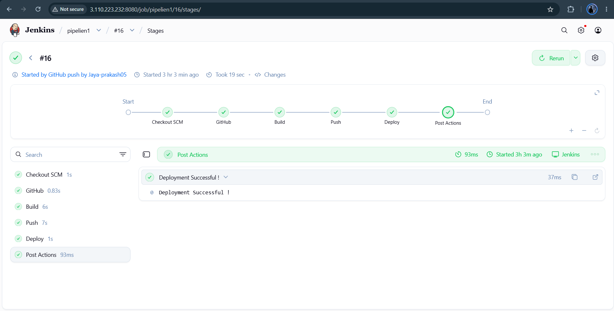
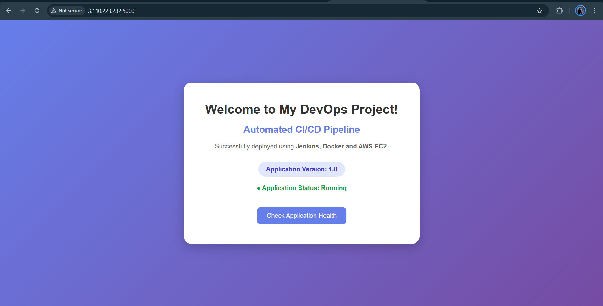
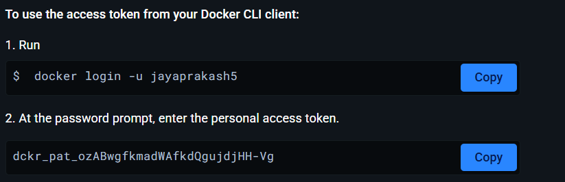

# Jenkins CI/CD Pipeline with Docker, GitHub Webhooks & AWS EC2

## Project Overview

This project demonstrates an automated Continuous Integration and Continuous Deployment (CI/CD) pipeline using **Jenkins, Docker, GitHub Webhooks, Docker Hub, and AWS EC2**.

A Python Flask web application is integrated with Jenkins to automate the application deployment process.

Whenever a developer pushes code changes to the GitHub repository, a GitHub Webhook automatically triggers the Jenkins pipeline. Jenkins then fetches the latest source code, builds a Docker image, pushes the image to Docker Hub, and deploys the updated application on an AWS EC2 instance.

The main objective of this project is to automate application deployment, reduce manual intervention, and understand real-world CI/CD workflows.

## Technologies Used

| Technology | Purpose |
|---|---| 
| AWS EC2 | Cloud hosting and deployment |
| Ubuntu Linux | Server operating system |
| Jenkins | CI/CD pipeline automation |
| Git | Version control |
| GitHub | Source code management |
| GitHub Webhooks | Automatic Jenkins pipeline triggering |
| Docker | Application containerization |
| Docker Hub | Docker image registry |
| Python | Application development |
| Flask | Web application framework |

## Project Architecture

```text
             Developer
                 |
                 | Git Push
                 v
          GitHub Repository
                 |
                 | GitHub Webhook
                 v
              Jenkins
                 |
          +------+------+
          |             |
          v             v
       Checkout       Build
          |             |
          |             v
          |         Docker Image
          |             |
          |             v
          |         Docker Hub
          |             |
          |             v
          |          Deploy
          |             |
          +-------------+
                        |
                        v
                    AWS EC2
                        |
                        v
                Docker Container
                        |
                        v
                  Flask Web App
                    Port 5000
```

## How the CI/CD Pipeline Works

The project uses GitHub Webhooks to automate the Jenkins pipeline.

### 1. GitHub Webhook Integration

- Configure a GitHub Webhook to connect the GitHub repository with Jenkins.
- Whenever code is pushed to the GitHub repository, GitHub sends an HTTP POST notification to Jenkins.
- Jenkins receives the webhook event and automatically triggers the pipeline.
- No manual build triggering is required.

### 2. GitHub - Source Code Checkout

- Jenkins connects to the GitHub repository.
- Retrieves the latest source code from the `main` branch.
- Prepares the application files for the build process.

### 3. Build - Docker Image Creation

- Jenkins uses the Dockerfile to build the application image.
- Installs the required Python dependencies.
- Creates a Docker image for the Flask application.

### 4. Push - Docker Hub

- Jenkins authenticates with Docker Hub using stored Jenkins credentials.
- Tags the newly created Docker image.
- Pushes the image to the Docker Hub repository.

### 5. Deploy - AWS EC2

- The deployment process connects to the AWS EC2 environment.
- Pulls the latest Docker image from Docker Hub.
- Stops and removes the previous application container if it exists.
- Creates and starts a new container using the latest image.
- Maps container port `5000` to host port `5000`.

## Application Details

The project uses a Python Flask web application.

**Application features:**

- Simple web interface.
- Flask-based application.
- Docker containerized deployment.
- Accessible through the EC2 public IP address.

**Application URL:**

```text
http://<EC2-PUBLIC-IP>:5000
```

## Project Screenshots

### 1. Jenkins Pipeline Execution

This screenshot shows the Jenkins CI/CD pipeline execution, including source code checkout, Docker image building, pushing the image to Docker Hub, and deployment.



### 2. Final Application Output

This screenshot demonstrates the final Flask web application successfully running after the CI/CD deployment process.



### 3. AWS EC2 Instance Running State

This screenshot shows the AWS EC2 instance running, which is used for hosting the Jenkins and application deployment environment.



## Project Setup and Execution

### Prerequisites

- AWS EC2 Ubuntu instance.
- Jenkins installed and configured.
- Docker installed and configured.
- GitHub account.
- Docker Hub account.
- GitHub Webhook configured.
- Required Jenkins credentials configured.

### Step 1: Clone the Repository

```bash
git clone https://github.com/Jaya-prakash05/Jenkins-Docker-CI-CD.git

cd Jenkins-Docker-CI-CD
```

### Step 2: Configure GitHub Webhook

1. Open your GitHub repository.
2. Navigate to Settings.
3. Select Webhooks.
4. Click Add webhook.
5. Enter your Jenkins webhook URL:

```text
http://<JENKINS-PUBLIC-IP>:8080/github-webhook/
```

6. Select `application/json` as the content type.
7. Select the push event.
8. Save the webhook.

### Step 3: Configure Jenkins

1. Create a Jenkins Pipeline job.
2. Configure the GitHub repository URL.
3. Select the `main` branch.
4. Configure the job to use the repository's Jenkinsfile.
5. Configure the required Docker Hub credentials.
6. Enable the GitHub hook trigger for GITScm polling.

### Step 4: Configure Docker Hub Credentials

- Open Jenkins Credentials.
- Add your Docker Hub username and password or access token.
- Use the credential ID referenced in your Jenkinsfile.

### Step 5: Execute the Pipeline

Push a code change to GitHub:

```bash
git add .
git commit -m "Update application"
git push origin main
```

GitHub Webhook automatically notifies Jenkins, which triggers the CI/CD pipeline.

Jenkins executes the configured stages and deploys the updated application.

### Step 6: Access the Application

Open your browser:

```text
http://<EC2-PUBLIC-IP>:5000
```

Make sure the required inbound ports are allowed in the AWS EC2 security group.

## Key Learnings

- Implemented an automated CI/CD pipeline using Jenkins.
- Integrated GitHub with Jenkins using Webhooks.
- Automated pipeline triggering on GitHub push events.
- Built Docker images using Dockerfiles.
- Integrated Docker Hub with Jenkins credentials.
- Deployed containerized applications on AWS EC2.
- Worked with Ubuntu Linux and Docker commands.
- Understood real-world Continuous Integration and Continuous Deployment workflows.

## Repository Structure

```text
Jenkins-Docker-CI-CD/
│
├── screenshots/
│   ├── jenkins_pipeline.png
│   ├── final_outcome.png
│   └── aws_instance_running.png
│
├── app.py
├── Dockerfile
├── Jenkinsfile
├── requirements.txt
├── .gitignore
└── README.md
```

## Author

**Jaya Prakash**

- GitHub: https://github.com/Jaya-prakash05
- LinkedIn: https://www.linkedin.com/in/jaya-prakash-data/

---

⭐ If you find this project useful, feel free to explore the repository and give it a star.
